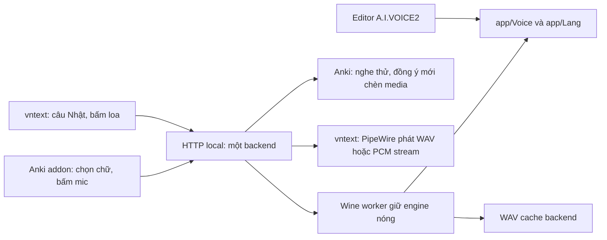

# Nối A.I.VOICE2 với Anki và vntext — hướng dẫn dev mới

Cập nhật: 2026-11-07. Phạm vi đã dùng: Linux x86-64, Wine, Anki Desktop
native và vntext trên Wayland có layer-shell. Windows native/Anki Flatpak
chưa được kiểm chứng trong bộ hướng dẫn này.

Mục tiêu: một bản A.I.VOICE2, một backend giữ engine nóng, hai client dùng
chung. Cài và xác minh WAV trước; nâng cấp streaming là bước tùy chọn.

## 1. Thành phần và đường đi của âm thanh



Anki/vntext không tự load DLL. Editor GUI không cần mở để TTS chạy.
GUI và worker có Wine prefix riêng, cùng đọc dữ liệu giọng trong một app.

| Thành phần | Lấy ở đâu | Công dụng |
|---|---|---|
| Bundle Anki 0.2.0 | Repo private `aquaplatinumberlitz/aivoice2-anki` | Setup Qt, addon, backend WAV, worker đã build, dev-kit/docs |
| MSI Editor 2.14.1 | Bộ cài được cung cấp riêng | App và engine; không gồm Lang/voicebanks |
| Lang và voicebanks | Dữ liệu được cung cấp riêng | Từ điển Standard/Kansai và các giọng được chọn |
| vntext | Repo `aquaplatinumberlitz/vntext` | Trích text, dịch/tra từ, client TTS và backend nâng cấp tùy chọn |

Bundle 0.2.0 gốc **chỉ có API WAV**, chưa có PCM streaming, preparation hay
quota WAV mới của vntext. vntext vẫn dùng được backend này bằng WAV.
Backend nâng cấp nằm ở `vntext/integrations/aivoice2/`; phải thay cả
server và worker cùng phiên bản khi triển khai nó.

Helper `ailm.dll` chọn FreeLicenseManager cho tầng GUI; `gui_patch.py`
patch `app.so` gốc lấy từ MSI để xử lý UX Deactivate. `app.patch.json` là
báo cáo hash/patch, không phải input điều khiển patch. Setup làm các bước này.
Không cần patch thêm khi nối client HTTP. Vẫn giữ `aitalk.lic`, `voice.lic`
runtime đi kèm dữ liệu; không dùng activation cá nhân hay clone Wine prefix.

## 2. Chuẩn bị và đặt tên các đường dẫn

Khách chỉ cần runtime: Python 3, PySide6 hoặc PyQt6, Wine, msitools
(`msiextract`) và Anki Desktop. vntext cần các dependency trong README repo
vntext và `pw-play`; dev build worker nâng cấp cần MinGW x86-64.

Mở Bash và khai báo ba biến. Đây là ví dụ máy hiện tại; máy khác thay bằng
đường dẫn của mình. Luôn giữ dấu nháy vì đường dẫn có khoảng trắng:

```bash
export AIVOICE_BUNDLE='/mnt/m2sata/A.I.VOICE2-futago/aivoice2-anki'
export VNTEXT_REPO='/mnt/m2sata/A.I.VOICE2-futago/vntext'
export AIVOICE_ROOT="$HOME/.local/share/aivoice2-local"
export PYTHONDONTWRITEBYTECODE=1
```

`AIVOICE_BUNDLE` là repo/bộ bàn giao; `AIVOICE_ROOT` là **bản đã cài**.
Không trỏ ROOT vào repo, thư mục voicebanks hoặc Wine prefix.
Các lệnh sau giả định ROOT đúng bản muốn dùng, cùng tài khoản Linux chạy Anki.

## 3. Cài mới bằng setup

1. Đóng Anki nếu chọn cài addon. Chạy lệnh dưới để mở wizard.
2. Chọn MSI Editor 2.14.1, nguồn Lang và nguồn voicebanks.
3. Đánh dấu giọng muốn dùng. Akane dùng Kansai; các giọng còn lại dùng
   Standard theo quy tắc bộ bàn giao. Mỗi bank phải có đủ dữ liệu và runtime lic.
4. Chọn thư mục cài **mới**: ví dụ AIVOICE_ROOT ở trên. Không cài đè bản đang có.
5. Chọn tạo backend, shortcut và kết nối Anki; chọn đúng thư mục `addons21`.
6. Cài đặt và kiểm tra tới 100%; dùng Nghe thử và mở Anki/Editor nếu cần.

```bash
bash "$AIVOICE_BUNDLE/start-setup.sh"
```

Nếu đã có bản cài hoạt động, bỏ qua bước cài mới. Dùng shortcut Quản lý để
thêm/gỡ giọng; không tự copy lẻ `.aivdic` vì còn registry, Lang và manifest.

Layout sau cài:

```text
<AIVOICE_ROOT>/
  app/                      # Editor, engine, Voice/, Lang/, runtime .lic
  runtime/                  # server.py, engine_worker.exe, support modules
  config/runtime.json       # đường dẫn, port, default voice
  prefixes/gui/             # GUI settings riêng
  prefixes/engine/          # backend engine riêng
  manager/                  # quản lý bản cài/giọng
  backups/                  # file stock, giọng gỡ, backup integration
  install-manifest.json     # hash file đã cài
  integration.json          # unit/shortcut/addon/API URL của đúng instance
```

Đường dẫn tương đối trong runtime.json tính từ **thư mục chứa config**.
Wine aliases V:, R:, O: lần lượt trỏ app, runtime, cache. Giữ nguyên các
alias do setup tạo; không dùng `--worker` trỏ ra ngoài runtime đã map trong
prefix cũ để thử, vì alias R: khác đích sẽ bị từ chối.

## 4. Tìm URL và service thật, không đoán cổng

Mặc định source là 17862 nhưng setup có thể chọn cổng khác khi cổng bận.
Máy hiện tại dùng **17863**. Đọc từ bản đã cài:

```bash
python3 "$AIVOICE_ROOT/runtime/runtime_cli.py" \
  --config "$AIVOICE_ROOT/config/runtime.json" show-config

export AIVOICE_URL="$(python3 - <<'PY'
import json, os
from pathlib import Path
root = Path(os.environ['AIVOICE_ROOT'])
data = json.loads((root / 'config/runtime.json').read_text())
print('http://127.0.0.1:' + str(data.get('port', 17862)))
PY
)"
export AIVOICE_UNIT="$(python3 - <<'PY'
import json, os
from pathlib import Path
root = Path(os.environ['AIVOICE_ROOT'])
print(json.loads((root / 'integration.json').read_text())['unit_name'])
PY
)"
printf 'URL: %s\nUnit: %s\n' "$AIVOICE_URL" "$AIVOICE_UNIT"
systemctl --user status "$AIVOICE_UNIT" --no-pager
```

Nếu service đã được tạo nhưng đang dừng: `systemctl --user start "$AIVOICE_UNIT"`.
Nếu chưa có integration.json, quay lại Quản lý để bật backend/kết nối Anki.
Không khởi động server thứ hai trên cùng prefix/cổng. Không chạy service bằng sudo.

Kiểm tra file trước khi đổ lỗi cho client:

```bash
python3 "$AIVOICE_ROOT/runtime/runtime_cli.py" \
  --config "$AIVOICE_ROOT/config/runtime.json" diagnose
python3 "$AIVOICE_ROOT/runtime/runtime_cli.py" \
  --config "$AIVOICE_ROOT/config/runtime.json" verify-files
curl --fail --silent --show-error --noproxy '*' "$AIVOICE_URL/healthz"
curl --fail --silent --show-error --noproxy '*' "$AIVOICE_URL/v1/voices"
```

Mong đợi: `files_ready: true`, `passed: true`, health `ready: true`, danh sách
voices có `id` hợp lệ. `id` có dạng `thư-mục/tên-package`; không tự gõ tên
hiển thị như “Akane” thay id. `instance_id` giúp phân biệt hai bản cài.
`diagnose` và hash pass chưa chứng minh có tiếng ở loa.

## 5. Test một câu ngoài Anki/vntext

Lệnh này hỏi đúng một câu mẫu và ghi WAV ở thư mục tạm; không đọc text game,
không phát loa tự động. Chọn default voice mà API công bố:

```bash
python3 - <<'PY'
import io, json, os, tempfile, urllib.request, wave
from pathlib import Path
base = os.environ['AIVOICE_URL'].rstrip('/')
http = urllib.request.build_opener(urllib.request.ProxyHandler({}))
with http.open(base + '/v1/voices', timeout=5) as response:
    catalog = json.load(response)
voice = catalog['default_voice']
assert voice and any(v['id'] == voice for v in catalog['voices'])
body = json.dumps({'text': 'こんにちは。', 'voice': voice}, ensure_ascii=False).encode()
request = urllib.request.Request(base + '/v1/speak', data=body,
    headers={'Content-Type': 'application/json; charset=utf-8'})
with http.open(request, timeout=120) as response:
    data = response.read()
with wave.open(io.BytesIO(data), 'rb') as audio:
    assert (audio.getnchannels(), audio.getsampwidth(), audio.getframerate()) == (1, 2, 48000)
    assert audio.getnframes() > 0
    print('WAV OK:', audio.getnframes(), 'frames; voice:', voice)
path = Path(tempfile.mkdtemp(prefix='aivoice2-check-')) / 'sample.wav'
path.write_bytes(data)
print('Open this file to listen:', path)
PY
```

Mở WAV vừa in ra bằng trình phát hoặc `pw-play '/đường/dẫn/sample.wav'`.
Nếu không có tiếng: kiểm tra thiết bị âm thanh/PipeWire; đừng sửa DLL khi
WAV đã hợp lệ. Lần nạp giọng đầu có thể chậm, cache hit sau không đại diện
thời gian tổng hợp một câu hoàn toàn mới.

## 6. Nối Anki

1. Setup đã cài addon thì mở lại Anki. Nếu cài thủ công, dùng **Tools →
   Add-ons → Install from file…**, chọn `anki/aivoice2-local.ankiaddon`
   trong bundle rồi khởi động lại Anki. Anki-Connect không bắt buộc cho addon TTS.
2. Trong **Tools → Add-ons**, chọn **A.I.VOICE2 Local TTS → Config**.
   Đặt `api_url` bằng AIVOICE_URL vừa đọc. Giữ các thiết lập khác của khách.
   Setup thường đã điền đúng URL nên không cần sửa.
3. Tạo/mở note, chọn chữ Nhật rồi bấm mic trên editor, hoặc mở Tools →
   A.I.VOICE2. Làm mới danh sách giọng, chọn giọng, nghe thử đúng câu.
4. Chỉ bấm **Đồng ý · Chèn vào card** khi muốn lưu file vào media và thêm
   `[sound:...]` vào field. Preview/đóng dialog không chèn audio.
5. Kiểm tra card phát lại; media Anki đã chèn là dữ liệu độc lập với cache
   backend. Xóa cache WAV không xóa âm thanh trong collection.

Ví dụ config addon (thay URL bằng cổng thực; voice phải có trong `/v1/voices`):

```json
{
  "api_url": "http://127.0.0.1:17863",
  "voice": "KotonohaAkane_ns_48/KotonohaAkane_ns_48",
  "source_field": "",
  "audio_field": ""
}
```

Anki native thường lưu addon dưới `~/.local/share/Anki2/addons21/aivoice2_local`.
Portable/custom data cần chọn đúng đường dẫn trong manager. Không chép đè
meta.json khi Anki đang mở; ưu tiên màn hình Config hoặc manager lúc Anki đóng.
Romaji và nghĩa Việt không được addon tự sinh.

## 7. Nối vntext vào cùng URL

Build vntext theo README nếu chưa có binary:

```bash
cd "$VNTEXT_REPO"
cargo build --release --locked
./target/release/vntext
```

1. Người dùng mở game, chọn game trong vntext rồi **Hiện phụ đề**.
2. Bấm loa hoặc bánh răng → **Giọng đọc → Kết nối nâng cao**.
3. Nhập AIVOICE_URL, ví dụ `http://127.0.0.1:17863`, rồi bấm **Làm mới giọng**
   để áp dụng/lưu. Chọn giọng có trong backend và bấm **Nghe thử**.
4. Quay về game, bấm loa cạnh câu Nhật để nghe; chế độ chỉ bản dịch vẫn đọc
   Nhật gốc. Quét chữ Nhật → chuột phải → Nghe phần Nhật đã chọn.
5. Chỉ bật **Tự đọc câu Nhật mới** khi muốn tự phát theo game; mặc định tắt.
   Nếu bản cũ không công bố streaming, client tự dùng WAV.

Config vntext ở `${XDG_CONFIG_HOME:-$HOME/.config}/vntext/tts.json`:
`endpoint` dùng chung; `games` giữ voice, volume, automatic, prepare theo game.
Ryujinx ưu tiên Title ID trong tiêu đề; nếu không có ID thì cấu hình theo phiên.
Đừng thay cả file config bằng ví dụ rỗng làm mất lựa chọn của các game khác.
Sau khi sửa config bằng file thay vì UI, thoát/mở lại phiên vntext để nạp lại.

Sau bước này Anki và vntext phải dùng **cùng một URL và instance_id**.
Không cần thêm service “cho vntext”. Khi cả hai yêu cầu cùng lúc, backend
tuần tự hóa synth; mỗi client có phần phát âm thanh riêng.

## 8. Nâng cấp backend chung để có streaming/cache quota (dev, tùy chọn)

Bỏ qua bước này nếu chỉ cần kết nối hoạt động. Thư mục bundle 0.2.0 giữ
nguyên để checksum phát hành vẫn tái hiện được. Nâng cấp **bản đã cài**, không
thay payload trong bundle hoặc tự sửa hash phát hành.

Bản nâng cấp: `server.py`, `scheduler.py`, `wav_cache.py` và
`engine_worker.exe` build từ **cùng commit vntext**. Hai module support
`runtime_config.py`, `run_auth_probe.py`, registry, GUI patch, Lang/Voice
vẫn lấy từ bản cài. Worker dùng giao thức timing/PCM khi server bật cờ tương
ứng; trộn server/worker sai bản có thể làm treo kênh trả lời.

```bash
cd "$VNTEXT_REPO"
mkdir -p target/tts-runtime
x86_64-w64-mingw32-gcc -Wall -Wextra -Werror -O2 -Wl,--no-insert-timestamp \
  integrations/aivoice2/engine_worker.c -o target/tts-runtime/engine_worker.exe
export AIVOICE2_SUPPORT_DIR="$AIVOICE_ROOT/runtime"
python3 tests/test_tts_backend.py
```

Mong đợi 13 test backend qua, không cần engine thật trong các test đó.
Tiếp theo lưu/đóng Editor, dừng playback Anki/vntext, rồi dừng đúng service:

```bash
systemctl --user stop "$AIVOICE_UNIT"
```

Đoạn triển khai dưới kiểm hash hiện tại trước khi thay, khóa bảo trì, backup
cặp server/worker và manifest, tạo receipt. Nếu thấy hash-mismatch thì dừng
điều tra; không cập nhật manifest chỉ để bỏ qua lỗi.

```bash
python3 - <<'PY'
import hashlib, json, os, shutil, subprocess, sys, tempfile
from pathlib import Path
root = Path(os.environ['AIVOICE_ROOT']).resolve()
repo = Path(os.environ['VNTEXT_REPO']).resolve()
sys.path.insert(0, str(root / 'manager/src/setup'))
sys.path.insert(0, str(root / 'runtime'))
from runtime_config import load_config
from runtime_cli import verify_files
from voice_manager import maintenance
config = load_config(root / 'config/runtime.json')
assert config.runtime_dir == root / 'runtime' and config.app_dir == root / 'app'
assert verify_files(config)['passed'], 'Existing installation has unexpected file changes'
sources = {
    'server.py': repo / 'integrations/aivoice2/server.py',
    'scheduler.py': repo / 'integrations/aivoice2/scheduler.py',
    'wav_cache.py': repo / 'integrations/aivoice2/wav_cache.py',
    'engine_worker.exe': repo / 'target/tts-runtime/engine_worker.exe',
}
assert all(p.is_file() for p in sources.values())
sha = lambda p: hashlib.sha256(p.read_bytes()).hexdigest()
with maintenance(root, config):
    parent = root / 'backups/integration'
    parent.mkdir(parents=True, exist_ok=True)
    backup = Path(tempfile.mkdtemp(prefix='shared-tts-', dir=parent))
    targets = [root / 'runtime' / n for n in sources]
    targets += [root / 'runtime/worker-manifest.json', root / 'install-manifest.json']
    before = {}
    for path in targets:
        rel = path.relative_to(root).as_posix()
        before[rel] = path.exists()
        if path.exists():
            dest = backup / rel
            dest.parent.mkdir(parents=True, exist_ok=True)
            shutil.copy2(path, dest)
    try:
        for name, source in sources.items():
            dest = root / 'runtime' / name
            temp = dest.with_name(dest.name + '.upgrade')
            shutil.copy2(source, temp)
            temp.replace(dest)
        path = root / 'runtime/worker-manifest.json'
        worker = json.loads(path.read_text())
        worker.update(worker_protocol='vntext-pcm-metrics-v1',
            worker_sha256=sha(root / 'runtime/engine_worker.exe'),
            files={n: sha(repo / 'integrations/aivoice2' / n)
                   for n in ['engine_worker.c', 'engine_api.h']})
        path.write_text(json.dumps(worker, indent=2) + '\n')
        path = root / 'install-manifest.json'
        manifest = json.loads(path.read_text())
        for name in [*sources, 'worker-manifest.json']:
            manifest['files']['runtime/' + name] = sha(root / 'runtime' / name)
        path.write_text(json.dumps(manifest, ensure_ascii=False, indent=2) + '\n')
        assert verify_files(config)['passed']
        receipt = {'vntext_commit': subprocess.check_output(
            ['git', '-C', str(repo), 'rev-parse', 'HEAD'], text=True).strip(),
            'before': before, 'after': {p.relative_to(root).as_posix(): sha(p) for p in targets}}
        (backup / 'receipt.json').write_text(json.dumps(receipt, indent=2) + '\n')
    except BaseException:
        for rel, existed in before.items():
            dest = root / rel
            if existed:
                shutil.copy2(backup / rel, dest)
            else:
                dest.unlink(missing_ok=True)
        raise
print('Upgrade backup:', backup)
PY
systemctl --user start "$AIVOICE_UNIT"
curl --fail --silent --show-error --noproxy '*' "$AIVOICE_URL/healthz"
```

Mong đợi health `ready: true`, capabilities có `prepare-v1`, `warm-v1`,
`pcm-stream-v1`; `wav_cache.limit_bytes = 536870912`. Unit cũ vẫn chạy đúng
`runtime/server.py --config ...`; không cần tạo unit thứ hai. Server vntext
hiện nhận `--worker` tùy chọn nên dùng được worker ngay trong runtime_dir.

Chạy lại bài test câu mẫu ở mục 5 và thử cả hai client. Dùng manager để
thêm/gỡ giọng vẫn phải đóng Editor/dừng service đúng instance. Không dùng
“Tiếp tục khởi tạo” hay cài lại runtime cũ làm cách nâng cấp: nó có thể dùng
snapshot backend cũ, không phải bản streaming đã triển khai.

Rollback nếu cần: dừng service, lấy đúng backup vừa in, khôi phục từng file
trong `receipt.json.before` từ đường dẫn tương ứng dưới backup; file ghi
`false` trước nâng cấp thì gỡ nó. Khôi phục cả worker-manifest và
install-manifest cùng bộ, chạy verify-files rồi bật service. Không trộn
backup khác thời điểm. Client vntext tự lùi về WAV khi backend cũ không
công bố streaming. Đợt mất điện giữa cập nhật cần dev kiểm tra backup/receipt,
không được coi đoạn script này là updater chịu được mọi sự cố.

## 9. Warm-up, lookahead và cache: hiểu đúng để hỗ trợ

| Cơ chế | Hành vi hiện tại |
|---|---|
| Giữ engine nóng | Worker Wine sống lâu, không load engine lại mỗi câu |
| Warm voice | Nạp/chọn Lang và voice; không tổng hợp câu giả |
| Chuẩn bị câu hiện tại | Khi bật prepare, đã chọn giọng, game có focus và tự đọc tắt; tối đa 160 ký tự |
| Lookahead | Sau khi bắt đầu nghe, chuẩn bị 1 đoạn index+1 ngắn; OCR không có đoạn sau, không chuẩn bị menu ▶ |
| Nhiều nhánh/load save | Hủy/thay pending theo revision; audio đã đoán không tự phát. Tác vụ native đang chạy không hủy được |
| WAV backend nâng cấp | PCM stream trực tiếp trong lúc worker vẫn ghi WAV cache; quota 512 MiB, dọn không dùng 7 ngày, bảo vệ file đang đọc/ghi |
| RAM vntext | Cache nghe lại 32 MiB, tối đa 7 bản ghi hiện thực, tái dùng trong 120 giây; không timer xóa ngay khi hết hạn |

Giữ lookahead 1 làm mặc định với VN nhiều nhánh. Không tăng ngay lên 3–5:
worker chỉ synth một tác vụ, nhánh đoán sai đang chạy có thể khiến câu user
muốn nghe phải chờ. Chỉ thử 2 đoạn khi profile biết đường tuyến tính và đo
được tỷ lệ dùng audio dự đoán/độ trễ có ích. Quota RAM không tăng số đoạn
lookahead; model/voice đang nạp và bộ đệm phát nằm ngoài quota cache RAM.

## 10. Khoanh vùng lỗi nhanh

| Triệu chứng | Kiểm tra và hướng xử lý |
|---|---|
| Connection refused | Đúng URL trong runtime.json? Đúng unit đã start? Hai client có cùng cổng? |
| Health 503/not ready | Đọc journal đúng unit và worker log trong log_dir; kiểm worker/engine hash và prefix |
| HTTP 400/Unknown voice | Lấy id từ `/v1/voices`, Refresh sau thêm/gỡ giọng; chọn lại giọng nếu id cũ mất |
| Lang/voice thiếu | Chạy diagnose, dùng Quản lý đăng ký cả bank; không chỉ chép `.aivdic` |
| Akane/Aoi nghe giống | Kiểm registry/Lang Akane=Kansai, Aoi=Standard; thử cùng câu `です。`; không giả khác bằng pitch |
| auth=-3/talker NULL | Đúng bộ engine/runtime lic/prototype đã kiểm chứng? Đọc finding đã gỡ lỗi; không xóa `.lic` hay đoán NULL |
| WAV đúng nhưng không nghe | Kiểm player, PipeWire và output device; xác nhận loa bằng sample ngoài client |
| Anki chèn sai field | Cấu hình source/audio field và phần chọn; kiểm trong note thử trước |
| vntext không có câu Nhật | Chọn Nhật + dịch, mở dải và focus game; kiểm engine extraction. Đây có thể tách biệt lỗi backend TTS |
| Shin mở lại trống | Dùng bản vntext có sửa chọn SNR guest/thứ tự tìm vị trí; Higurashi dùng chung code nhưng cần QA game riêng |
| Chuyển câu vẫn nghe cũ | Phân biệt dừng playback với hủy synth; không tạo nhiều phiên reader/service để “chữa” |
| Cổng bận | Tìm unit/instance thực sự dùng cổng; giữ một backend chung, không kill wineserver toàn máy |
| Hash mismatch sau sửa tay | So backup/receipt cập nhật có chủ đích; không cập nhật hash để che file lỗi |

```bash
journalctl --user -u "$AIVOICE_UNIT" -n 50 --no-pager
python3 "$AIVOICE_ROOT/runtime/runtime_cli.py" \
  --config "$AIVOICE_ROOT/config/runtime.json" support-preview
```

Support preview chỉ xuất metadata; xem nội dung trước khi gửi. Không gửi
collection, thoại game hàng loạt, raw license hoặc credential môi trường.

## 11. Dev sửa ở đâu và giữ hợp đồng nào

Các đường dẫn trong bảng tính từ gốc repo được chỉ rõ. Sửa source trước,
chạy test rồi triển khai có backup; sửa file trong bản đã cài không tự cập
nhật source hoặc payload phát hành.

| Việc cần sửa | Repo và file đầu tiên nên đọc |
|---|---|
| HTTP, chọn giọng, vòng đời worker | vntext: `integrations/aivoice2/server.py` |
| Hàng chờ, prepare/cancel, ưu tiên câu đang nghe | vntext: `integrations/aivoice2/scheduler.py` |
| WAV quota, tuổi file và lease | vntext: `integrations/aivoice2/wav_cache.py` |
| Gọi engine dưới Wine, trả PCM/timing | vntext: `integrations/aivoice2/engine_worker.c`, `engine_api.h` |
| Client HTTP, cache nghe lại, player | vntext: `src/tts.rs`; nút/dải và prepare trong `src/overlay.rs` |
| Dialog Anki, preview/chèn media | Anki: `developer-kit/src/anki-addon/__init__.py`, `selection.js`, `editor_compat.py` |
| Config/diagnose/service của runtime | Anki: `src/daemon/runtime_config.py`, `runtime_cli.py` |
| Cài đặt, đăng ký giọng, shortcut/addon | Anki: `src/setup/manager.py`, `voice_manager.py`, `integrations.py` |
| Finding RE, build helper và GUI patch | Anki: `developer-kit/docs/DEV_HANDOVER_INDEX_VI.md`, `developer-kit/src/free-client/README.md` |

Client mới bắt đầu bằng ba API ổn định: `GET /healthz`, `GET /v1/voices`,
`POST /v1/speak` với JSON `{"text":"こんにちは。","voice":"id-từ-catalog"}`.
`/v1/speak` trả binary WAV; đọc HTTP status trước khi giải mã audio. Xem
đoạn Python mục 5 làm ví dụ tối thiểu. Không gọi DLL, đọc license hoặc tự
spawn Wine từ client; một backend quản lý engine cho cả hai ứng dụng.

Chỉ dùng `/v1/speak/stream`, `/v1/prepare`, `/v1/cancel` khi health công bố
capability tương ứng. Hợp đồng frame PCM `AVS1`, session/revision và giới
hạn hàng chờ nằm trong [README backend vntext](https://github.com/aquaplatinumberlitz/vntext/blob/main/integrations/aivoice2/README.md).
Một session cho mỗi phiên client; revision tăng khi đổi câu/giọng. HTTP 202
của prepare chỉ có nghĩa đã nhận việc. Stream chỉ thành công khi có frame
kết thúc thành công; ngắt HTTP giữa chừng không được cache như audio hoàn chỉnh.

Test backend nằm ở `vntext/tests/test_tts_backend.py`. Test addon/setup và
cơ chế đã RE nằm trong `Anki/developer-kit/tests/`; đọc chỉ mục bàn giao
để chọn test liên quan, không chạy tool research lên bản khách đang dùng.
Bundle giữ snapshot source/payload gốc: sửa `developer-kit` chưa có nghĩa
addon đang cài hoặc `build/payload` đã đổi. Khi phát hành bản mới phải build
đúng artifact, kiểm manifest và tăng version; không sửa hash bản 0.2.0 cũ.

## 12. Checklist trước khi báo “đã nối xong”

- [ ] Bản cài đúng version; diagnose và verify-files đều pass.
- [ ] Chỉ một service cho Anki/vntext; cùng URL, đúng instance, ready=true.
- [ ] `/v1/voices` có giọng đã chọn; sample WAV đúng câu, định dạng và nghe được.
- [ ] Anki preview không chèn; đồng ý mới tạo media; card phát lại được.
- [ ] vntext nghe câu Nhật gốc, nghe phần chọn, dừng/chuyển câu không phát audio cũ.
- [ ] Thêm/gỡ giọng: stop/maintain/start, làm mới cả hai client và chọn lại id nếu cần.
- [ ] Nếu nâng cấp: có backup/receipt/hash, health có streaming, WAV Anki vẫn hoạt động.
- [ ] Ghi giới hạn thực tế (distro, Wine, Anki, game); không suy rộng một sample thành QA mọi môi trường.

Tài liệu giống nhau được lưu trong cả hai repo tại `docs/AIVOICE2_CONNECT_VI.md`.
Các ghi chú RE trong developer-kit phản ánh bundle lịch sử; hướng nối runtime
chung hiện hành theo tài liệu này và source `integrations/aivoice2` của vntext.
